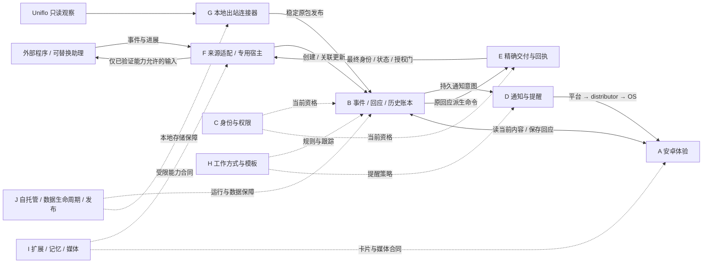

# 工程地图：说明与资料索引

> **公开镜像适配：** HTML是主入口，本页是全产品职责与本地合同索引，不是当前公开源码能力或统一发布声明。可点击路径仅表示本分支已有相应文件/片段，不表示它包含本地同名文件的全部接口；其余标为“本地合同”，不补导入源码、任务或私有材料。执行状态只归本地 `docs/roadmap.md`；公开范围另见[公开状态](status.md)，不代替实施路线。
>
> 本次原11项输入表SHA256：`10bea251aa4225ee60281b61a955a8611d465cefc24d94d06a4a2ca2484b58e4`；原HTML SHA256：`e3ebc4486b40dff8007d366a155fa72a934a6005ec3e8aa80903666544700675`。原MD说明SHA256：`ea4b3326424c29611d36985cd548387ea54de2cbe5c11ae7196cebaba2874a3f`；公开哈希和裁剪适配另列本次提交说明。它替代旧MD-only格式，不抹旧提交或赋予产品发布/恢复权限。

**主入口：[交互式工程地图（HTML）](engineering-map.html)。** 下载或直接双击本地HTML即可使用，不需要启动后端、联网CDN或模型。它以三级节点、端口连线和右侧详情对照“应具备能力—现有落点—缺口/待核实项—依据”，支持搜索、缩放、层级/依赖切换、关联聚焦、四类缺口和关键路径检查；本文保留为文字说明与合同索引，不是HTML的替代交付。

资源管理与消息处理的[参考候选及待核问题](engineering-map/REFERENCE-CANDIDATES.md)另列。Magpie/Prime Agent尚未取得用户所指准确仓库，不据截图选择框架、编造API或迁入私人助理平台。

这份地图回答：**产品由哪些系统组成、各块负责什么、接口在哪里、完整产品还需要哪些能力合同。** 它不是开发进度表，也不是新增服务的部署方案。

- 产品目标取自[需求基线](requirements.md)，选择取自决策记录（本地合同：`docs/decisions.md`），运行职责取自[系统架构](architecture.md)与插件提案（本地合同：`docs/plugins.md`）。
- **实施、测试、独审、暂停、阻塞和发布版本只看实施路线（本地合同：`docs/roadmap.md`）。** 下列源码／TASK入口不代表该能力已经交付、可在公开main消费或获得部署授权。
- 工程仍是 **Kotlin/Compose安卓客户端＋一个Fastify/TypeScript事件服务＋SQLite＋按需薄适配器**。系统是职责边界，不要求拆成十个服务；`pi-host`可与事件服务同进程，本地连接器才需要独立出站运行。
- 范围标记：**〔首〕** 已确认的第一轮往返；**〔日〕** 日常可用与可靠性深化；**〔扩〕** 保留的后续能力。标记不是完成度，也不表示安全与持久化可以延后。

## 1. 一眼看全：系统 → 功能块

```text
通知与交互产品（不是围绕某个模型的聊天客户端）
├─ A 安卓体验与交互
│  ├─ 收件箱、当前事件详情、历史、分层回执、明确已读与事项决定〔首〕
│  ├─ 按钮/文字回应、稳定原请求与未知结果对账〔首〕
│  ├─ 加密离线缓存、区间/容量、草稿/快捷回复、性能与忙态反馈〔日〕
│  └─ 主动新对话入口、复杂卡片与媒体呈现〔扩；须先有真实合同〕
├─ B 事件、回应与事项账本
│  ├─ 来源事件创建/更新、版本、历史、幂等与事务〔首〕
│  ├─ 交互实例占用、回应保存、阅读状态与用户决定〔首〕
│  └─ 关联项目/事项、跨端变更同步与完整生命周期〔日/扩〕
├─ C 身份、设备与权限
│  ├─ owner/用户/来源隔离、来源代次与能力、当前写入门〔首〕
│  ├─ 设备配对、凭据轮换/撤销、安装身份与原未决意图〔日〕
│  └─ 插件/工具/模型的显式范围、期限与预算授权〔扩〕
├─ D 通知、提醒策略与同步
│  ├─ 通知意图/发件箱、设备登记、平台/设备/OS分层回执〔首〕
│  ├─ 私有ntfy＋UnifiedPush、权限/渠道、锁屏隐私与恢复〔首/日〕
│  └─ 静默/合并/重要性、多设备与真正的变更同步〔日/扩〕
├─ E 精确来源交付与证据
│  ├─ 原回应派生命令、身份/版本/期限/权限再核验〔首〕
│  ├─ 原生提交门、单活/去重、准确会话收件回执〔首〕
│  └─ unknown只读对账、原命令进展/结果、独立核验边界〔首/日〕
├─ F 来源适配与可替换助理
│  ├─ HTTP程序/脚本来源、云端澪的独立App会话、专用Pi宿主〔首〕
│  ├─ 来源能力、运行观察、模型许可与持久使用边界〔日〕
│  └─ 更多AI/作业适配、主动分配专用会话、助理替换与共享摘要〔扩〕
├─ G 本地连接器与Uniflo观察
│  ├─ 主动出站、私有传输spool、稳定原包/ACK与重连〔扩〕
│  ├─ 显式选择、快照/实时流、原事件映射、水位与缺口〔扩〕
│  └─ 有界容量/诊断/背压、安全扩容/归档与长期维护〔日/扩〕
├─ H 工作方式、模板与持续跟办
│  ├─ 默认“变化→影响→需要用户→证据”的通知/交互方案〔首：薄配置〕
│  ├─ 触发/匹配、通知规则、回复模板、只读跟踪〔日/扩〕
│  └─ 方案分享/导入、依赖与权限差异、助理无关的记录〔扩〕
├─ I 扩展、记忆与媒体合同
│  ├─ 来源/助理/记忆/通知/工具扩展点与受控生命周期〔首：薄接口；扩：管理〕
│  ├─ 外部记忆、带来源/时间/范围的摘要与检索〔扩〕
│  └─ 受控工具/MCP、媒体上传取回保留、版本化复杂卡片〔扩〕
└─ J 自托管可靠性与发布
   ├─ 配置/部署、TLS/私有访问、故障诊断、来源暂停与HTTP保活〔首/日〕
   ├─ 容量/保留、备份/密钥、冻结恢复/对账、受限计划交接〔日〕
   └─ 升级/兼容、干净构建、签名分发、许可与真实支持矩阵〔日/扩〕
```

另一手机平台、桌面端、官方托管、多用户组织、可视化编排和插件市场仍是后续候选（本地合同：`docs/requirements.md#7-第一轮范围与后续候选`），不默认为首轮承诺，也不从地图中抹掉。

## 2. 一张依赖图

实线表示主要数据／交付路径；虚线表示横向约束或扩展衔接，**不是完成状态或实际网络拓扑**。H/I中的完整扩展合同仍按提案理解。



读图的关键：手机不直接连接本地AI；助理和记忆不代管公共账本；通知不承载完整权威内容；**G当前的发布/观察路径不等于E的命令接收或原生输入能力**。

## 3. 各系统的工程落点

以下API为本地源码中的定位入口，完整字段以模块README及严格schema为准；不是新接口设计或统一发布清单。任务链接是既有工程合同，不复述其结论。公开镜像可能不含全部任务／在制源码，不能为补齐链接而带入私人材料。

### A. 安卓体验与交互

解决“看懂当前事项、明确回应、离线不丢资料、未知不重复提交”。列表/详情/设置是产品入口，性能、字号/旋转、可访问反馈及真实后台限制都属于体验，而不只是能生成APK。

- **代码**：[Android说明](../android/README.md)；[MainActivity](../android/app/src/main/java/dev/notifier/app/MainActivity.kt)、[Ledger](../android/app/src/main/java/dev/notifier/app/Ledger.kt)、[OfflineInbox](../android/app/src/main/java/dev/notifier/app/OfflineInbox.kt)、[ResponseDrafts](../android/app/src/main/java/dev/notifier/app/ResponseDrafts.kt)、[ReadOnlyAutoSync](../android/app/src/main/java/dev/notifier/app/ReadOnlyAutoSync.kt)。Keystore/AtomicFile分别保管连接/原意图、内容缓存、通知和偏好。
- **衔接**：消费B的事件/回应/历史、C的设备身份、D的推送和E的回执。离线草稿不是已保存回应；恢复网络不自动发送。列表区间不是全库归档，缓存可回应标记不授予写权。
- **完整能力边界**：主动新对话、媒体与复杂卡片先满足需求§6.1（本地合同：`docs/requirements.md#61-后续客户端能力的服务端合同前提`），不能用原回应API或占位按钮冒充。性能调查工具与产品修复分开。
- **追溯**：R03–R07/R09/R14；T002（本地合同：`docs/tasks/T002-android-client.md`）、T008（本地合同：`docs/tasks/T008-offline-inbox.md`）、草稿/模板（本地合同：`docs/tasks/android-001-drafts-templates.md`）、缓存窗口（本地合同：`docs/tasks/android-002-cache-windows.md`）、性能调查（本地合同：`docs/tasks/android-003-cache-latency-investigation.md`）、读取体验（本地合同：`docs/tasks/android-004-cache-read-experience.md`）；验收（本地合同：`docs/acceptance.md`） A03/A06–A09/A28/A30。

### B. 事件、回应与事项账本

解决“同一事项持续存在，进展、用户回应和决定不散成多条聊天”。公共服务拥有权威事件、版本、交互占用、幂等事实和历史，不把AI摘要当原始记录。

- **代码/接口**：[后端说明](../server/README.md)；[core.ts](../server/src/core.ts)、[contracts.ts](../server/src/contracts.ts)、[routes.ts](../server/src/routes.ts)、[schema.ts](../server/src/schema.ts)。`/v1/events`及其`updates/responses/history/read-state/disposition`、`/v1/responses/{id}`是定位入口。
- **衔接**：同事务保存事件/回应/历史/通知意图；回应交E，通知意图交D。已读、待回应、来源收件、用户完成/停止跟踪相互独立，迟到进展不能重开用户决定。
- **完整能力边界**：关联事项/项目、配置同步与真正的变更游标按产品合同细化。现有事件列表按创建顺序分页，不能当更新订阅；草案中的`/v1/sync`不是当前分页API的别名。
- **追溯**：R02–R07/R09；T001（本地合同：`docs/tasks/T001-event-response-store.md`）、T003（本地合同：`docs/tasks/T003-source-delivery.md`）；验收（本地合同：`docs/acceptance.md`） A01/A02/A06/A08–A10/A17/A18/A28。

### C. 身份、设备与权限

解决“谁能看、谁能发布、哪台设备能回应、撤销后哪些新动作必须停止”。用户、来源、设备安装与模型凭据不能混作一个身份。

- **代码/接口**：[auth.ts](../server/src/auth.ts)、[device-authority.ts](../server/src/device-authority.ts)、[device-routes.ts](../server/src/device-routes.ts)、[device-store.ts](../server/src/device-store.ts)；Android的[DeviceIdentity](../android/app/src/main/java/dev/notifier/app/DeviceIdentity.kt)。入口包括配对claim、device self/rotate/revoke、原身份操作查询及受限管理CLI。
- **来源绑定**：source-binding.ts（本地合同：`server/src/source-binding.ts`）及传输合同（本地合同：`server/README.md#来源传输作用域绑定可选协议1`）约束owner/actor/source/epoch；`GET /v1/source/self`只是source主体自查，**不是用户可见来源目录、授权或新会话创建能力**。
- **衔接**：当前资格贯穿B/E/D的实际门，不只在客户端按钮或一次GET检查。撤销不抹已保存回应、原命令或未知效果；设备库只存认证事实，不成为第二事件账本。扩展/工具/模型授权还需各自明确范围与预算。
- **追溯**：R05/R07/R09/R13；T010（本地合同：`docs/tasks/T010-device-pairing-credentials.md`）、source-binding（本地合同：`docs/tasks/backend-next-source-binding.md`）；验收（本地合同：`docs/acceptance.md`） A09/A13/A14/A20/A21/A29/A30。

### D. 通知、提醒策略与同步

解决“来源变化能在后台提醒，又不泄露正文、不把旧通知当当前事实”。通知是权威事件的提醒和定位，不是另一份事件数据库。

- **代码/接口**：[notifications.ts](../server/src/notifications.ts)、[notification-routes.ts](../server/src/notification-routes.ts)；Android的[PushWorkers](../android/app/src/main/java/dev/notifier/app/PushWorkers.kt)、[PushProtocol](../android/app/src/main/java/dev/notifier/app/PushProtocol.kt)、[NoticePreferences](../android/app/src/main/java/dev/notifier/app/NoticePreferences.kt)。入口为`/v1/device/push`、`/v1/notifications`及原delivery receipt。
- **衔接**：B发件箱→配置的私有ntfy→UnifiedPush distributor→WorkManager/OS→认证后取当前事件；C管设备及端点代次，A展示当前/较早版本回执。平台接受、设备收到、请求OS提醒、用户看到/已读分别表达。
- **完整能力边界**：本机静默/隐私/系统渠道设置与H的共享规则不是同一配置；跨设备偏好、通知合并及真正变更同步需各自合同。渠道接通、模拟器与物理设备支持矩阵不相互替代，不承诺即时必达。
- **追溯**：R06/R07/R14/R15；T004（本地合同：`docs/tasks/T004-notifications.md`）、T009（本地合同：`docs/tasks/T009-notification-preferences.md`）、T006隔离平台入口（本地合同：`docs/tasks/T006-android-emulator-integration.md`）；验收（本地合同：`docs/acceptance.md`） A04–A07/A09/A24/A25/A30。

### E. 精确来源交付与证据

解决“用户对这张卡的回应，只到准确原目标，不能因重试执行两遍”。它是公共可靠性核心，不交给模型自行判断。

- **代码/接口**：[delivery.ts](../server/src/delivery.ts)、[delivery-routes.ts](../server/src/delivery-routes.ts)、[source-adapter.ts](../server/src/source-adapter.ts)。`/v1/source/commands`的claim/get/validate/receipt/updates负责原命令事实；实际输入在进程内`DeliveryStore.submitAtGate`与受信NativeHost处。
- **衔接**：B固定原回应/目标，C核当前权限，F在最终提交边界核原生会话、修订、期限、单活并持久保存关联收件。后续结果归原命令/原事件；来源报告不自动变成独立核验。
- **完整能力边界**：HTTP validate、`reply`能力或观察到会话均不是原生输入许可；没有通用HTTP execute。其他平台要实现各自精确提交/去重/只读查回执合同。unknown只查原ID与事实，不换目标、渠道或请求重发。
- **追溯**：R05–R09/R13；T003（本地合同：`docs/tasks/T003-source-delivery.md`）、T005（本地合同：`docs/tasks/T005-pi-app-runtime.md`）；验收（本地合同：`docs/acceptance.md`） A03/A07–A14/A17/A18/A29。

### F. 来源适配与可替换助理

解决“程序和不同助理能进入同一事件体系，而不是把可靠性绑定某个人格”。云端澪是首个适配对象，使用独立App会话，不自动续接已有工作聊天。

- **代码/接口**：[Pi宿主说明](../pi-host/README.md)；[native.ts](../pi-host/src/native.ts)、[runtime.ts](../pi-host/src/runtime.ts)、[identity.ts](../pi-host/src/identity.ts)、[credentials.ts](../pi-host/src/credentials.ts)、[model-budget.ts](../pi-host/src/model-budget.ts)。普通程序可使用B的认证HTTP发布；外部Webhook/其他AI格式由相应薄适配器转换，不默认提供任意回调执行器。
- **衔接**：E管理原命令交付，宿主管专用原生会话/模型run，B保留公共历史；[source-runtime观察](../server/src/source-runtime.ts)向A提供准确事件/代次关联的受限运行信息。模型许可配置、原生收件、真实模型请求、来源结果是不同事实；渠道`/send`不是AI输入。
- **完整能力边界**：主动新对话需要用户可见的权威来源/epoch和创建能力、稳定请求→原创建事实查询、先持久分配新会话/事件再执行；不能靠回应现有事件创建。持续模型使用须明确持久授权/预算，不重置旧许可。更换助理保留公共偏好/模板/记录/摘要，不转移旧命令所有权或未知效果。
- **追溯**：R02/R05/R06/R11/R13、需求§6.1（本地合同：`docs/requirements.md#61-后续客户端能力的服务端合同前提`）；T005（本地合同：`docs/tasks/T005-pi-app-runtime.md`）、T007（本地合同：`docs/tasks/T007-mio-live-app.md`）、T011（本地合同：`docs/tasks/T011-source-paused-service.md`）；验收（本地合同：`docs/acceptance.md`） A03/A13/A14/A17–A20。

### G. 本地连接器与Uniflo观察

解决“电脑不开放入站端口、断网仍保传输事实，恢复后不漏掉已承诺的消息”。本地spool负责传输，不复制服务端的回应/命令权威账本。

- **代码/接口**：连接器说明（本地合同：`connectors/README.md`）；transport.mjs（本地合同：`connectors/src/transport.mjs`）、spool.mjs（本地合同：`connectors/src/spool.mjs`）、uniflo.mjs（本地合同：`connectors/src/uniflo.mjs`）、CLI（本地合同：`connectors/src/cli.mjs`）。脚本入队create/update，向B出站发布；Uniflo只GET显式快照/流并映射原事件。
- **衔接**：传输须满足C的准确作用域绑定；水位、映射和outbox一起持久化。断流重快照只补当前状态，不伪造离线连续历史，idle不当作停工/完成。Uniflo观察键/标题/路径不提供E所需的原生目标证明。
- **完整能力边界**：容量/背压、只读诊断、扩容/归档/轮换是不同合同；腾工作容量不能忘掉ID、原wire、已用事实、FIFO、unknown/pending。存储维护不是旧快照恢复或来源执行门。将来若增加本地命令接收，仍须另满足E，而非从当前publish-only推导。
- **追溯**：R02/R07/R08/R10/R13/R15；出站/观察（本地合同：`docs/tasks/connector-001-outbound-uniflo.md`）、真实daemon隔离入口（本地合同：`docs/tasks/connector-002-real-uniflo-daemon.md`）、容量/诊断（本地合同：`docs/tasks/connector-003-spool-capacity.md`）、存储生命周期（本地合同：`docs/tasks/connector-004-storage-lifecycle.md`）；验收（本地合同：`docs/acceptance.md`） A11/A15/A16/A25–A27/A29/A30。

### H. 工作方式、模板与持续跟办

解决“如何筛选变化、什么时候打扰、怎样提问及跟踪”，把通用做法留下，而不是迁入私人助理规则。

- **设计入口**：插件提案§6默认方案（本地合同：`docs/plugins.md#6-默认项目助理方案`）、需求U3–U6（本地合同：`docs/requirements.md#5-典型用户流程`）。现有局部落点包括A的本机快捷回复/草稿、D的通知偏好、B的事项决定；它们**不等于完整共享工作方式引擎或服务端模板库**。
- **衔接**：规则使用B的已保存事实，控制D的提醒并引用E的已授权操作；普通进展可静默，待决交互不能被误合并。持续只读跟踪、自动催办和自动执行是不同权限，不从“空闲”猜需要输入。
- **完整能力合同**：声明式方案的版本/依赖/配置、模板与预注册动作引用、跟踪/退避/预算、导入差异和能力确认。分享使用配置槽位，不含实例身份或有效授权；更换助理保留配置，不重建已交付命令。可视化编排是候选，不是先决条件。
- **追溯**：R03/R04/R11–R13；局部合同可查草稿/模板（本地合同：`docs/tasks/android-001-drafts-templates.md`）、通知偏好（本地合同：`docs/tasks/T009-notification-preferences.md`），完整方案合同见plugins（本地合同：`docs/plugins.md`）；验收（本地合同：`docs/acceptance.md`） A17–A20/A23/A24。

### I. 扩展、记忆与媒体合同

解决“在可靠核心之外扩展能力，又不让插件、模型或摘要获得隐含授权”。这里按能力接口拆分，不预建插件市场或通用执行平台。

- **设计入口**：plugins.md（本地合同：`docs/plugins.md`）中的来源/助理/记忆/规则/通知/工具扩展点。`Plugin / SourceAdapter / MemoryAdapter`等是语义提案，不是已发布SDK方法；同进程代码及能力清单不构成强沙箱。当前Pi宿主的窄问题工具不是通用MCP/插件执行器。
- **记忆/工具**：外部后端选择见D06；检索/摘要须带来源、时间、可见范围，可降级，不能成为唯一任务/授权/回执库。工具/API/MCP动作必须经过明确能力与范围检查；DSH原生兼容、动态装载/升级/分发另有兼容及隔离决策。
- **卡片/媒体**：当前B的动作schema是button/text。单选/多选/小表单等需版本化schema、动作实例、提交/重新确认合同，A按已知组件渲染；附件/图片/语音需owner/事件绑定、有界上传/取回/保留、MIME/字节/完整性、版本/过期/撤销拒绝。媒体存在不自动授予模型处理或工具权限，也不引入任意URL代理。
- **追溯**：R04/R11–R13、需求§6.1（本地合同：`docs/requirements.md#61-后续客户端能力的服务端合同前提`）、D05/D06；验收（本地合同：`docs/acceptance.md`） A14/A19–A23/A26/A30。专门的媒体/复杂卡片/工具任务须随实际合同细化，不能把提案示例当可调用端点。

### J. 自托管可靠性与发布

解决“长期运行、能解释故障、安全保存/恢复、能独立构建和分发”。这是所有系统的支撑面，不是额外的业务编排服务。

- **代码/入口**：[server运行说明](../server/README.md)、[Pi宿主说明](../pi-host/README.md)、部署入口说明（本地合同：`pi-host/deploy/README.md`）；`pi-host/src/backup-* / restore-* / handoff-*`与[恢复门](../server/src/recovery-gate.ts)。配置/TLS/私有目录、数据和独立密钥、日志脱敏、资源关闭各有边界；生成部署文件不是启用服务。
- **运行与生命周期**：来源暂停不停止HTTP保存；模型启动不可用时的显式HTTP保活与手动暂停是不同功能。还需覆盖服务端/手机/连接器各自容量、保留与幂等事实、升级失败、归档、备份外部引用和未知效果诊断，不能把某一模块的限额当全产品配额。
- **恢复边界**：加密备份/惰性材料、原路径冻结安装、当前权限/未知效果对账及受控启用分开。连续活源参与的禁模型计划交接不能泛化为任意旧备份解冻；校验文件可读不重建旧耐久ACK，不退款旧模型请求或重发未知动作。
- **发布边界**：锁文件/可复现入口、schema/API兼容、产品命名/许可证、正式签名/分发和真实设备/网络/来源支持矩阵。源码公开、构建产物、正式发布与生产运维不是同一件事；平台/依赖版本范围以各组件及实际运行组合分别核对。
- **追溯**：R01/R07/R13–R15；T011（本地合同：`docs/tasks/T011-source-paused-service.md`）、模型降级保HTTP合同（本地合同：`docs/tasks/backend-next-model-degraded-http.md`）、T012备份（本地合同：`docs/tasks/T012-encrypted-backup-materials.md`）、T013冻结恢复（本地合同：`docs/tasks/T013-enforced-frozen-restore.md`）、T014受限计划交接（本地合同：`docs/tasks/T014-matching-state-model-disabled-enable.md`），G的存储任务与各模块README构建入口；验收（本地合同：`docs/acceptance.md`） A09/A10/A20/A25–A30。

## 4. 范围与真正的依赖

| 能力组合 | 要解决的用户问题 | 真正依赖／不应误设的前置 |
| --- | --- | --- |
| **首轮：云端澪独立App会话 ↔ 安卓** | 文本/按钮/文字回应、准确原会话收件、原事件更新与真实推送 | A–F的必要部分＋J的认证/持久化/独立部署。必须有精确来源与真实渠道合同；不要求先建G、外接记忆、插件市场或可视化编排。 |
| **日常可用** | 离线阅读与未知对账、可理解的忙态、设备生命周期、通知偏好、持续运行/诊断、容量及安全恢复 | 在各自原数据/身份/权限上深化A–G/J；本机缓存性能和本地spool容量可独立推进，不把一个来源或服务通道的障碍泛化为所有功能的依赖。 |
| **完整产品的后续扩展** | 更多来源、主动新对话、可替换助理/共享摘要、工作方式、记忆/工具、媒体和复杂交互 | H/I及A/F对应入口，仍依赖B/C/E/J的权威事实与安全门。先明确真实能力合同，再接客户端；具体发布范围/次序仍归需求、决定与路线。 |

**从基本往返走到完整产品，最重要的合同接缝是：**

1. **A↔F/C：主动发起专用会话**——权威来源/epoch与能力、稳定创建请求与查询、持久分配先于执行；原事件回应API不能替代。
2. **A↔B/D：完整变更同步**——事件更新、已读/回应/配置等变化的权威游标与失效重建，不把创建列表游标当同步。
3. **A↔I/B/C/J：复杂卡片与媒体**——schema/动作版本、对象归属、限额/完整性/保留、过期/撤销及重新确认；不是只增加几个UI组件。
4. **H↔I/F/B：方案、助理与记忆可替换**——共享配置/摘要与原始运行事实分离，导入不自动授权，旧任务不自动移交。
5. **J↔所有持久模块：长期运行与恢复**——持续使用许可、容量/保留/归档、当前性对账、兼容升级与真正支持矩阵，不能靠清库/换ID或重置额度恢复。

这些是功能合同边界，不是第二份待办/排期；已有任务不覆盖的部分不在本图虚构任务号、字段或实现承诺。

## 5. 阅读旧文档与当前代码时的边界

- `architecture.md`保留了起草时“尚未建立安卓客户端/尚未创建会话”等背景；`protocol-draft.md`也有早期T001能力描述。它们负责目标/提案，不能当作当前源码能力上限。地图的工程落点以各模块README及路由/源码为依据，实际候选/结论仍只查路线。
- 草案中的`/v1/items/{id}/dispositions`、`/v1/sync`和来源注册等候选路径不能直接调用；当前事项决定定位是`/v1/events/{id}/disposition`。插件Manifest的`draft-0`不是已冻结线上协议。
- 连接器的“出站发布/只读观察”与架构中未来的“本地命令通道”不同；SDK专用宿主的原生输入也不等于任意现有AI进程可接管。工具版本一致、健康检查或快照成功不能补这些合同。
- 模块README的最低版本声明、某个运行组合的验证、公开镜像包含哪些文件是不同信息，不互相外推。地图不重写其源码/范围或为任何候选签结论；实施路线（本地合同：`docs/roadmap.md`）仍是唯一执行状态入口。
