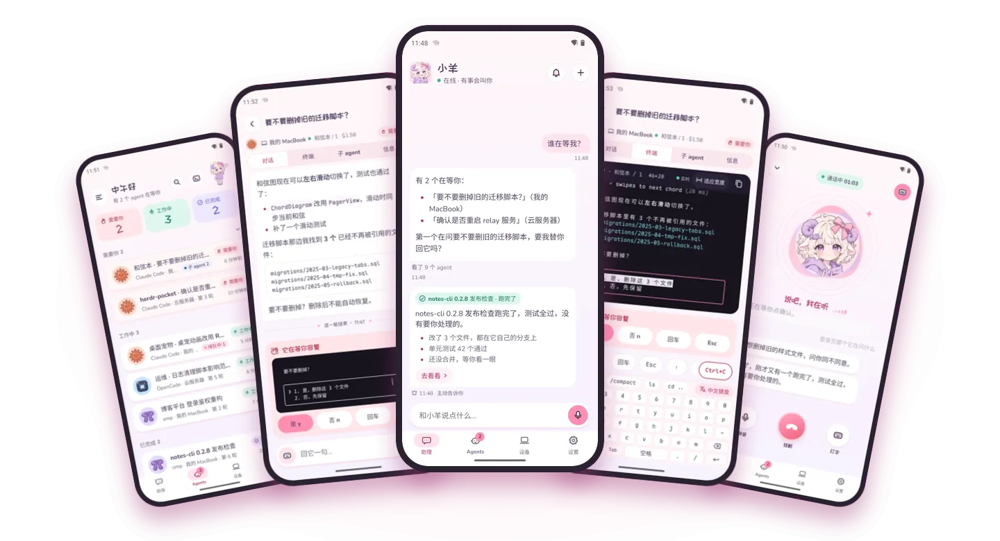
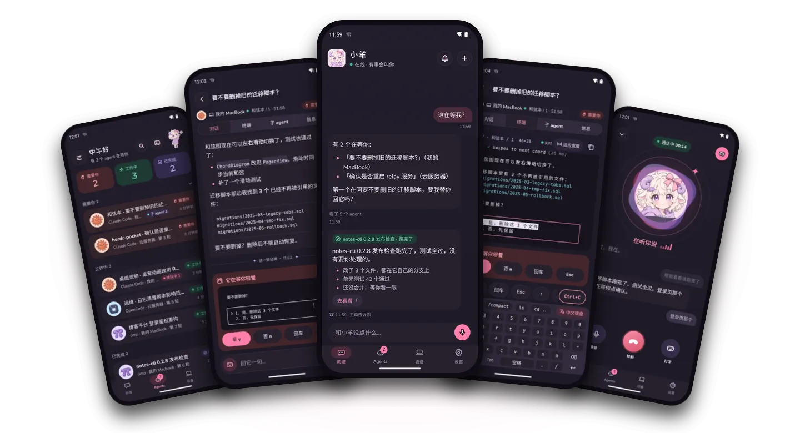

# 小爱小爱 / XiaoAiXiaoAi

This is our own Android App and relay assistant **爱弥斯**, adapted from the complete Herdr Pocket source. The upstream copyright and AGPL notices remain. Our app uses its own package, scheme, user-selected artwork and release signing; upstream APKs are not our deliverables. Remote updates/downloads remain disabled until an owned source is configured.

[Current delivery progress](<../docs/migrations/2026-11-17-xiaoaixiaoai-first-use.md>) · [Our Android app](<apps/mobile/README.md>) · [Local modifications](<MODIFICATIONS.md>) · [Model configuration](<docs/config.md>)

The original upstream documentation below is retained as reference. Its official release/website/install links describe **upstream**, not a download or deployment instruction for our fork. Our server deployment and real-account/device acceptance are recorded separately.

---

<p align="center"><b>English</b> | <a href="README.zh-CN.md">简体中文</a></p>

<div align="center">

<picture>
  <source media="(prefers-color-scheme: dark)" srcset="docs/readme/hero-en-dark.svg" />
  
</picture>

See what Claude Code, Codex, Gemini CLI and the other agents on each of your computers are doing, right from your phone.<br />
Message them, press keys, start new ones, or just call Xiaoyang, the assistant, and let her handle it.

*Your coding agents on every computer, in your pocket: a self-hosted relay, a small daemon per computer, and an Android app with a voice assistant.*

[](https://github.com/Crosery/herdr-pocket/releases/latest)
[](https://github.com/Crosery/herdr-pocket/actions/workflows/ci.yml)


[](LICENSE)

[Website](https://crosery.github.io/herdr-pocket/) · [Deploy](docs/deploy/README.md) · [Models and voice](docs/config.md) · [Download the Android app](https://github.com/Crosery/herdr-pocket/releases/latest) · [Website source](apps/site)

</div>

<p align="center">
  <picture>
    <source media="(prefers-color-scheme: dark)" srcset="docs/readme/showcase-dark.webp" />
    
  </picture>
</p>

<details>
<summary>Screenshots in the other theme</summary>
<p align="center">
  <picture>
    <source media="(prefers-color-scheme: dark)" srcset="docs/readme/showcase-light.webp" />
    
  </picture>
</p>
</details>

## What it does

<p align="center">
  <picture>
    <source media="(max-width: 600px) and (prefers-color-scheme: dark)" srcset="docs/readme/features-narrow-en-dark.svg" />
    <source media="(max-width: 600px)" srcset="docs/readme/features-narrow-en-light.svg" />
    <source media="(prefers-color-scheme: dark)" srcset="docs/readme/features-en-dark.svg" />
    
  </picture>
</p>

<details>
<summary><b>Every feature in detail</b></summary>

| | |
|---|---|
| **See it all** | The agents on every computer, sorted by state: working, waiting on you, done. Tap one for a formatted conversation (tool calls folded into cards) and a live terminal. |
| **Hands on** | Send messages and pictures, press Esc / Tab / arrows / Ctrl+C, and answer an agent's numbered choices with one tap. The terminal uses the app's own compact keyboard, so the system keyboard doesn't cover the screen; one tap switches back when you need to type Chinese. |
| **New agents** | In any space on any computer, start an agent installed on that computer: Claude Code, Codex, Gemini CLI, Kimi, Cursor Agent, Droid, CodeBuddy, Qoder, OpenCode… and hand it its first task at the same time. |
| **Xiaoyang** | One conversation for all your computers: ask who is waiting on you, where an agent is stuck, how much it has cost; have her pass on a message, press keys, start a new agent. By default she acts directly and tells you exactly how it went. When an agent gets stuck or finishes she speaks up on her own, pushing to the notification shade even while the app is closed, and she can set reminders. |
| **Call her** | Voice calls with Xiaoyang, so you can direct things while you walk. MOSS-Live by default, and the OpenAI Realtime protocol is supported too; nothing waits for a confirm tap during a call. |
| **Scan to connect** | QR codes are plain https links that any camera can scan. The first device on a new server just scans the code printed at startup; no keys to copy. |
| **Computer to computer** | From one computer's terminal, look at another computer's agents, send them messages and press keys. |
| **Your own server** | The relay runs on your own machine, with ready-made setups for Docker, Cloudflare Tunnel, Node + systemd, Fly.io, Render and Kubernetes. |
| **Auto updates** | The phone app, the computer command and the server all update from GitHub Releases. If an update on a computer or the server goes wrong, the old version stays in place, and you can roll back in one step. |
| **Logs** | Logs from the server, the computers and the phones all collect on the relay. Read them with `herdr-pocket logs` or the `/admin` console in your browser, or just ask Xiaoyang "where did it get stuck?" |

</details>

## How it connects

<p align="center">
  <picture>
    <source media="(max-width: 600px) and (prefers-color-scheme: dark)" srcset="docs/readme/architecture-narrow-en-dark.svg" />
    <source media="(max-width: 600px)" srcset="docs/readme/architecture-narrow-en-light.svg" />
    <source media="(prefers-color-scheme: dark)" srcset="docs/readme/architecture-en-dark.svg" />
    
  </picture>
</p>

- **Computer side** `herdr-pocket`: one background program per computer. It reads the agents in herdr, sends their state, conversations and terminals to the relay, and carries out what the phone asks for.
- **Relay**: handles device pairing and tokens, online status and request forwarding; Xiaoyang the assistant runs here too. Every device only ever connects out to it, so computers don't need to open any ports.
- **Phone app**: an Android app written with Expo / React Native.

## Quick start

You need: a server (Linux) that both your phone and your computers can reach, a computer with herdr installed (macOS, Linux or Windows), and an Android phone.

### 1. Deploy the relay

One command (uses Docker if it's there, otherwise Node + systemd):

```sh
curl -fsSL https://raw.githubusercontent.com/Crosery/herdr-pocket/main/scripts/install-relay.sh | sudo bash -s -- --domain pocket.example.com
```

| Your situation | Flags |
|---|---|
| You have a domain and the server can open ports 80/443 (Caddy sets up HTTPS automatically) | `--domain pocket.example.com` |
| The domain is on Cloudflare and you'd rather not open ports on the server (at home, on an internal network) | `--tunnel <token> --domain pocket.example.com` |
| No domain, just trying it out | `--tunnel quick` (a temporary trycloudflare address that changes on restart) |
| A LAN, or you already have your own reverse proxy in front | `--port 7420` |
| You don't want to install Docker | add `--native` |

Plain Docker Compose works too:

```sh
mkdir herdr-pocket && cd herdr-pocket
curl -fsSLO https://raw.githubusercontent.com/Crosery/herdr-pocket/main/deploy/docker/compose.yml
docker compose up -d
docker compose logs relay | grep "setup code"   # the setup code for the first device
```

For Fly.io, Render, Railway, Zeabur, Kubernetes and the details of every route, see the [deploy docs](docs/deploy/README.md). Whichever you pick, keep the database on persistent storage and run only one instance.

### 2. Connect the first device

While a new server has no devices yet, it prints a one-time setup code and QR code (valid for 30 minutes, single use):

```
[relay] setup code=MEOW-482193 link=https://pocket.example.com/p/MEOW-482193 expires=…
```

- **Phone first**: scan the QR code with your camera and tap “用 Herdr Pocket 打开” (Open with Herdr Pocket) on the page. If the app isn't installed yet, the page has a download link.
- **Computer first**: hand this link to the computer side; see the next step.

Lost it? Run `sudo herdr-pocket-relay setup` on the server to see it again; if it has expired, add `--new` for a fresh one.

### 3. Install the computer side

```sh
curl -fsSL https://raw.githubusercontent.com/Crosery/herdr-pocket/main/scripts/install-host.sh | bash -s -- --server https://pocket.example.com
```

It installs the `herdr-pocket` command and a background service that starts automatically (launchd on macOS, a systemd user service on Linux). The terminal shows a QR code: scan it with a phone that's already connected and tap “允许加入” (Allow). If this computer is the first device, replace `--server …` with the setup link from step 2: `… | bash -s -- https://pocket.example.com/p/<setup code>`.

The computer needs Node.js 22.18 or newer. If it doesn't have one, the installer downloads a separate copy that leaves the system's Node alone.

**Windows** (10 1809 or newer, or 11): run this in PowerShell instead. No administrator rights needed; it brings its own Node and starts Herdr Pocket hidden when you log on.

```powershell
& ([scriptblock]::Create((irm https://raw.githubusercontent.com/Crosery/herdr-pocket/main/scripts/install-host.ps1))) -Server https://pocket.example.com
```

For the first device, pass the setup link instead: `… -Link https://pocket.example.com/p/<setup code>`. Details in [docs/deploy/host.md](docs/deploy/host.md#windows).

### 4. Install the phone app

Download `herdr-pocket-<version>-android-arm64.apk` from [Releases](https://github.com/Crosery/herdr-pocket/releases/latest) and install it. After that the app tells you about new versions itself; one tap downloads and installs them.

### 5. Add more devices

Any device that's already connected can invite others. Invite codes are single use and valid for 10 minutes:

- Phone: in the app, “设备 → 邀请设备” (Devices → Invite device) shows a QR code, or send the link to another phone with the system share sheet.
- Computer: `herdr-pocket pair` prints a QR code in the terminal.
- Copy an invite link, then open the app: the home screen offers “用它连接” (Connect with it) right away.

## Setting up Xiaoyang

Xiaoyang runs inside the relay and is configured in the server's `relay.env` (the installer puts it at `/opt/herdr-pocket/relay.env`; with Docker it sits in the same directory as the compose file). Without a model, everything else in the app still works; there's just no assistant.

```sh
# Text models: provider:model, tried in order; when one fails or is too slow, the next takes over
POCKET_DEEPSEEK_API_KEY=sk-...
POCKET_QWEN_API_KEY=sk-...
POCKET_ASSISTANT_MODELS=deepseek:deepseek-flash,qwen:qwen3.7-plus

# Voice calls: MOSS-Live by default (recommended); add the key and you can call
POCKET_VOICE_KEY=...
# POCKET_VOICE_PROVIDER=openai-realtime

# Optional
# POCKET_TIMEZONE=Asia/Shanghai        # time zone Xiaoyang uses for the time and reminders
# POCKET_ASSISTANT_CONFIRM=never       # always: ask before acting in text chats (calls never wait for confirmation)
```

Built-in text model providers: Anthropic, OpenAI, DeepSeek, Qwen (Tongyi Qianwen), Kimi, Zhipu GLM, SiliconFlow, Volcano Engine Ark, OpenRouter, Gemini, Ollama (local), and any self-hosted gateway compatible with OpenAI or Anthropic. Each provider's address, variables and config-file format are in [docs/config.md](docs/config.md).

Ask before acting (“动手前先问我”) can also be switched in the app's settings or in `/admin`; the changed value is stored on the server.

## Command line

```sh
herdr-pocket up --server pocket.example.com   # register this computer and keep it online (login + run)
herdr-pocket pair                             # show an invite QR code to add a phone or another computer
herdr-pocket status                           # registration and connection state

herdr-pocket agents                           # agents on every online computer
herdr-pocket read  macbook/t42                # look at another computer's terminal
herdr-pocket send  macbook/t42 run the tests
herdr-pocket keys  macbook/t42 esc

herdr-pocket logs --since 1h --level warn     # logs recorded by the relay, the computers and the phones
herdr-pocket update                           # update to the latest version (--check only checks, --rollback goes back)
```

`herdr-pocket run --read-only` lets others look but not touch; `--allow <device id,…>` lets only the listed devices operate this computer. Xiaoyang calls computers as the relay (device id `relay`), so add it when you use `--allow`.

On the server, the matching command is `herdr-pocket-relay`: `setup`, `status`, `logs`, `update`, `version`.

## Updates

| | Command |
|---|---|
| Phone app | Prompts by itself when a new version is out; you can also check by hand in “设置 → 版本” (Settings → Version) |
| Computer | `herdr-pocket update` |
| Server | `sudo herdr-pocket-relay update`; with Docker, `docker compose pull && docker compose up -d` |

Computer and server updates first unpack the new version into a directory next to the current one and start it once as a trial; only if that works do they switch over and restart. If it fails, the old version is left untouched, and `--rollback` returns to the previous version. The release process is in [docs/deploy/updates.md](docs/deploy/updates.md).

## Logs and console

- **`/admin`**: open `https://pocket.example.com/admin` in a browser and enter `POCKET_ADMIN_TOKEN` (the installer generates one). It shows the version, online devices, the assistant's models, statistics for the last 24 hours, logs, and the actions Xiaoyang has taken; you can revoke devices and toggle ask before acting there.
- **`herdr-pocket logs`**: works from any registered computer. Filter by time, device, kind, level and keyword; `--follow` keeps watching.
- Phone and computer logs are uploaded to the relay periodically, with tokens and keys wiped out before upload.

## Security

- A device token appears only once, at pairing, and the server stores only its SHA-256. Revoke a device in the app or in `/admin` and it disconnects immediately.
- Invite codes are single use and expire after 10 minutes by default; 10 failures from the same IP lock it out for 10 minutes. A setup code exists only while the server has no devices at all.
- The QR code web page only shows what's already in its URL: it doesn't check whether the code is valid, isn't cached, and sends no referrer.
- The relay rewrites agent ownership according to each connection's identity, so a computer can't pose as another. A phone can only choose which program to start by name; it can't make a computer run arbitrary commands.
- Use HTTPS in production. **The relay can see the content in plaintext; there's no end-to-end encryption yet**, so deploy it on a machine you trust.

## Development

| Directory | Contents |
|---|---|
| `packages/protocol` | Versioned protocol for devices, agents, conversations, RPC, streams and pairing; cross-process changes start here |
| `packages/update` | Version numbers, GitHub Releases checks, in-place updates and rollback |
| `apps/relay` | The relay and Xiaoyang the assistant |
| `apps/hostd` | The computer-side background program and the `herdr-pocket` command line |
| `apps/mobile` | The Android app (Expo SDK 58), not part of the root pnpm workspace |
| `apps/site` | Website and intro video (Vite + three.js; the video is rendered with Remotion) |
| `deploy/`, `scripts/` | Docker, systemd, launchd, Fly, Render and k8s configs, and the install scripts |

```sh
pnpm install
pnpm typecheck
pnpm --filter @herdr-pocket/relay test
pnpm --filter @herdr-pocket/hostd test

cd apps/mobile && pnpm install && pnpm typecheck
```

You can look around the app without a server: on the connect screen, tap “还没有服务器？先逛逛演示数据” (No server yet? Look around with demo data). Collaboration conventions are in [AGENTS.md](AGENTS.md), the docs index is [docs/README.md](docs/README.md), and app development and packaging are in [apps/mobile/README.md](apps/mobile/README.md).

## License

Copyright © 2026 Crosery

Herdr Pocket is released under the [GNU Affero General Public License v3.0 only](LICENSE) (AGPL-3.0-only):

- You may freely use, study, modify and redistribute it, including commercially.
- If you distribute a modified version (an installer, an image, an archive), you must include the complete source under the same license.
- Even if you only deploy a modified relay or app for others to use over a network, without distributing the program, you must make the modified source available to those users. This is where the AGPL is stricter than the GPL.
- You may not fold it, or any part of it, into a closed-source product.
- This license grants no trademark rights to the “Herdr Pocket” name or logo. If you publish a modified version, give it a different name and package name, so nobody mistakes it for the official one.

**Additional permission under AGPL-3.0 section 7.** The website in `apps/site` may be combined with GSAP (distributed under its own “Standard no-charge” license), and the intro video project in `apps/site/video` with Remotion (distributed under the Remotion License), without those libraries falling under the AGPL. They keep their own terms: Remotion, for example, requires a paid company license above a certain team size. Neither library is used by the relay, the computer daemon or the Android app.
