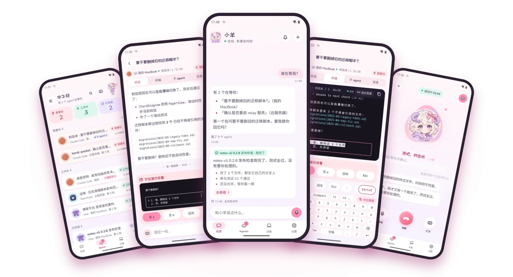
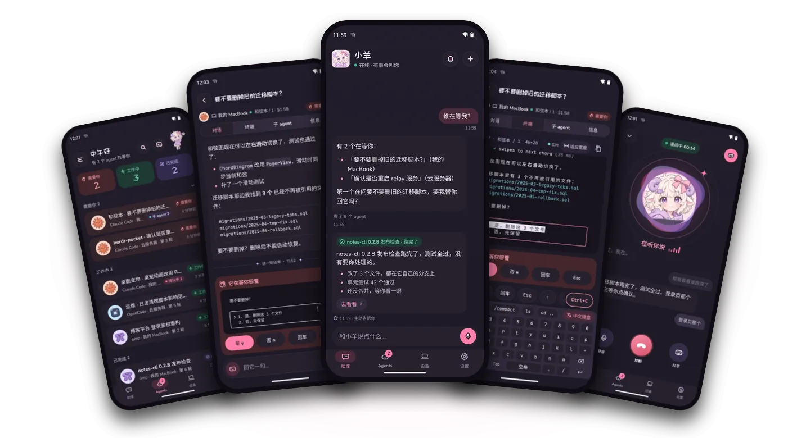

# 小爱小爱

当前产品是我们自己的Android App，助理名为**爱弥斯**。基于朋友完整Herdr Pocket源码改造，保留原版权与AGPL许可；自己的包名、scheme、用户指定头像、签名和安装产物独立，不能把朋友官方APK当交付。自有发布源未配置前，远程更新和配对下载入口关闭。

[首版交付真实进度](<../docs/migrations/2026-11-17-xiaoaixiaoai-first-use.md>) · [自己的Android端](<apps/mobile/README.md>) · [本地修改说明](<MODIFICATIONS.md>) · [模型配置](<docs/config.md>)

以下保留原上游文档作参考，其中官方发布、官网及安装链接属于原作者，不是“小爱小爱”的下载或部署指令。真实账号、部署与手机验收另行记录。

---

<p align="center"><a href="README.md">English</a> | <b>简体中文</b></p>

<div align="center">

<picture>
  <source media="(prefers-color-scheme: dark)" srcset="docs/readme/hero-zh-dark.svg" />
  
</picture>

在手机上看每台电脑里 Claude Code、Codex、Gemini CLI 这些 agent 在干什么，<br />
给它们发消息、按键、开新的，或者直接打电话让助理小羊替你去办。

*Your coding agents on every computer, in your pocket: a self-hosted relay, a small daemon per computer, and an Android app with a voice assistant.*

[](https://github.com/Crosery/herdr-pocket/releases/latest)
[](https://github.com/Crosery/herdr-pocket/actions/workflows/ci.yml)


[](LICENSE)

[官网](https://crosery.github.io/herdr-pocket/) · [部署](docs/deploy/README.md) · [模型与语音配置](docs/config.md) · [下载安卓 App](https://github.com/Crosery/herdr-pocket/releases/latest) · [官网源码](apps/site)

</div>

<p align="center">
  <picture>
    <source media="(prefers-color-scheme: dark)" srcset="docs/readme/showcase-dark.webp" />
    
  </picture>
</p>

<details>
<summary>另一套配色的截图</summary>
<p align="center">
  <picture>
    <source media="(prefers-color-scheme: dark)" srcset="docs/readme/showcase-light.webp" />
    
  </picture>
</p>
</details>

## 能做什么

<p align="center">
  <picture>
    <source media="(max-width: 600px) and (prefers-color-scheme: dark)" srcset="docs/readme/features-narrow-zh-dark.svg" />
    <source media="(max-width: 600px)" srcset="docs/readme/features-narrow-zh-light.svg" />
    <source media="(prefers-color-scheme: dark)" srcset="docs/readme/features-zh-dark.svg" />
    
  </picture>
</p>

<details>
<summary><b>每项功能的详细说明</b></summary>

| | |
|---|---|
| **一眼看全** | 所有电脑上的 agent 按状态排好：在干活、在等你、跑完了。点进去是排好版的对话（工具调用折成卡片）和实时终端。 |
| **随手操作** | 发消息和图片，按 Esc / Tab / 方向键 / Ctrl+C，agent 给出编号选项时点一下就能选。终端用 App 自带的紧凑键盘，不让系统输入法挡住屏幕，要打中文时一键切回去。 |
| **开新 agent** | 在任意一台电脑的任意空间里，启动那台电脑上装了的 agent：Claude Code、Codex、Gemini CLI、Kimi、Cursor Agent、Droid、CodeBuddy、Qoder、OpenCode…… 第一条任务一起交过去。 |
| **助理小羊** | 一个对话管所有电脑：问谁在等你、某个 agent 卡在哪、花了多少钱；让它传话、按键、开新的 agent。默认直接动手，结果照实告诉你。agent 卡住或跑完时它会主动说，App 关着也会推送到通知栏，还能设提醒。 |
| **打电话** | 和小羊语音通话，边走路边指挥。默认用 MOSS-Live，也支持 OpenAI Realtime 协议；通话里不用点确认。 |
| **扫码就连** | 二维码是普通的 https 链接，任何相机都能扫；新服务器的第一台设备扫启动时打印的码就行，不用复制密钥。 |
| **电脑互相调用** | 在一台电脑的终端里看另一台电脑的 agent、给它发消息、按键。 |
| **自己的服务器** | 中转服务部署在你自己的机器上：Docker、Cloudflare Tunnel、Node + systemd、Fly.io、Render、Kubernetes 都有现成配置。 |
| **自动更新** | 手机 App、电脑端命令和服务器都从 GitHub Releases 更新，电脑和服务器的更新出问题时保持原版本，也能一键退回。 |
| **有日志可查** | 服务器、电脑、手机的日志都汇总到中转服务，用 `herdr-pocket logs` 或浏览器里的 `/admin` 控制台查，也可以直接问小羊“卡在哪一步了”。 |

</details>

## 怎么连起来

<p align="center">
  <picture>
    <source media="(max-width: 600px) and (prefers-color-scheme: dark)" srcset="docs/readme/architecture-narrow-zh-dark.svg" />
    <source media="(max-width: 600px)" srcset="docs/readme/architecture-narrow-zh-light.svg" />
    <source media="(prefers-color-scheme: dark)" srcset="docs/readme/architecture-zh-dark.svg" />
    
  </picture>
</p>

- **电脑端** `herdr-pocket`：每台电脑一个后台程序，读 herdr 里的 agent，把状态、对话和终端发给中转服务，执行手机发来的操作。
- **中转服务** relay：负责设备配对和令牌、在线状态、请求转发，小羊助理也跑在这里。所有设备都只主动连它，电脑不用开端口。
- **手机 App**：Expo / React Native 写的安卓应用。

## 快速开始

需要：一台手机和电脑都能连上的服务器（Linux），装了 herdr 的电脑（macOS、Linux 或 Windows），一台安卓手机。

### 1. 部署中转服务

一条命令（有 Docker 就用 Docker，没有就用 Node + systemd）：

```sh
curl -fsSL https://raw.githubusercontent.com/Crosery/herdr-pocket/main/scripts/install-relay.sh | sudo bash -s -- --domain pocket.example.com
```

| 你的情况 | 参数 |
|---|---|
| 有域名，服务器能开 80/443 端口（Caddy 自动 HTTPS） | `--domain pocket.example.com` |
| 域名在 Cloudflare，服务器不想开端口（家里、内网） | `--tunnel <token> --domain pocket.example.com` |
| 没有域名，先试一下 | `--tunnel quick`（临时 trycloudflare 地址，重启会变） |
| 局域网，或者前面已经有自己的反向代理 | `--port 7420` |
| 不想装 Docker | 加 `--native` |

只用 Docker Compose 也可以：

```sh
mkdir herdr-pocket && cd herdr-pocket
curl -fsSLO https://raw.githubusercontent.com/Crosery/herdr-pocket/main/deploy/docker/compose.yml
docker compose up -d
docker compose logs relay | grep "setup code"   # 第一台设备用的设置码
```

Fly.io、Render、Railway、Zeabur、Kubernetes 和各种方式的细节见 [部署文档](docs/deploy/README.md)。不管哪种方式，数据库要放在持久存储上，并且只跑一个实例。

### 2. 连上第一台设备

新服务器还没有设备时，会打印一个一次性的设置码和二维码（30 分钟有效，只能用一次）：

```
[relay] setup code=MEOW-482193 link=https://pocket.example.com/p/MEOW-482193 expires=…
```

- **先连手机**：用相机扫这个二维码，网页上点“用 Herdr Pocket 打开”。还没装 App 时，页面上有下载链接。
- **先连电脑**：把这条链接交给电脑端，见下一步。

找不到了就在服务器上运行 `sudo herdr-pocket-relay setup` 再看一次，过期了用 `--new` 换一个。

### 3. 装电脑端

```sh
curl -fsSL https://raw.githubusercontent.com/Crosery/herdr-pocket/main/scripts/install-host.sh | bash -s -- --server https://pocket.example.com
```

它会装好 `herdr-pocket` 命令和开机自启的后台服务（macOS 用 launchd，Linux 用 systemd 用户服务）。终端会显示一个二维码，用已经连上的手机扫一下，点“允许加入”。第一台设备就是这台电脑时，把 `--server …` 换成第 2 步的设置链接：`… | bash -s -- https://pocket.example.com/p/<设置码>`。

电脑上要有 Node.js 22.18 或更新的版本，没有的话安装脚本会单独下载一份，不影响系统里的 Node。

**Windows**（10 1809 以上或 11）：在 PowerShell 里运行下面这条。不需要管理员权限，自带 Node，登录 Windows 后在后台自动上线，不弹窗口。

```powershell
& ([scriptblock]::Create((irm https://raw.githubusercontent.com/Crosery/herdr-pocket/main/scripts/install-host.ps1))) -Server https://pocket.example.com
```

第一台设备就是这台电脑时，改用设置链接：`… -Link https://pocket.example.com/p/<设置码>`。详见 [docs/deploy/host.md](docs/deploy/host.md#windows)。

在中国大陆，GitHub 慢的时候在脚本地址前加镜像：`https://ghfast.top/https://raw.githubusercontent.com/...`。脚本按时区判断，之后的下载和以后的更新都会自动先走镜像，见 [docs/deploy/updates.md](docs/deploy/updates.md#中国大陆)。

### 4. 装手机 App

从 [Releases](https://github.com/Crosery/herdr-pocket/releases/latest) 下载 `herdr-pocket-<版本>-android-arm64.apk` 安装。之后的新版本 App 会自己提示，点一下就下载安装。

### 5. 加更多设备

任何已经连上的设备都能邀请别的设备，邀请码一次性、10 分钟有效：

- 手机：App 里“设备 → 邀请设备”出二维码，或者用系统分享把链接发给另一台手机。
- 电脑：`herdr-pocket pair` 在终端里打印二维码。
- 复制了邀请链接再打开 App，首页会直接提示“用它连接”。

## 配置小羊

小羊跑在中转服务里，配置写在服务器的 `relay.env`（安装脚本放在 `/opt/herdr-pocket/relay.env`，Docker 方式放在 compose 同一目录）。不配模型也能用 App 的其他功能，只是没有助理。

```sh
# 文字模型：provider:model，按顺序尝试，前一个失败或太慢就换下一个
POCKET_DEEPSEEK_API_KEY=sk-...
POCKET_QWEN_API_KEY=sk-...
POCKET_ASSISTANT_MODELS=deepseek:deepseek-flash,qwen:qwen3.7-plus

# 语音通话：默认 MOSS-Live（推荐），填上 key 就能打电话
POCKET_VOICE_KEY=...
# POCKET_VOICE_PROVIDER=openai-realtime

# 可选
# POCKET_TIMEZONE=Asia/Shanghai        # 小羊报时和提醒用的时区
# POCKET_ASSISTANT_CONFIRM=never       # always：文字对话里先问再动手（通话从不等确认）
```

内置的文字模型厂商：Anthropic、OpenAI、DeepSeek、通义千问、Kimi、智谱 GLM、硅基流动、火山方舟、OpenRouter、Gemini、Ollama（本地），以及任意 OpenAI 或 Anthropic 兼容的自建网关。每家的地址、变量和配置文件写法见 [docs/config.md](docs/config.md)。

“动手前先问我”也可以在 App 的设置里或 `/admin` 里切换，改过的值存在服务器上。

## 命令行

```sh
herdr-pocket up --server pocket.example.com   # 登记这台电脑并保持在线（login + run）
herdr-pocket pair                             # 出一个邀请二维码，加手机或别的电脑
herdr-pocket status                           # 登记和连接状态

herdr-pocket agents                           # 所有在线电脑的 agent
herdr-pocket read  macbook/t42                # 看另一台电脑的终端
herdr-pocket send  macbook/t42 跑一下测试
herdr-pocket keys  macbook/t42 esc

herdr-pocket logs --since 1h --level warn     # 查中转服务、电脑、手机记下的日志
herdr-pocket update                           # 更新到最新版本（--check 只检查，--rollback 退回）
```

`herdr-pocket run --read-only` 只让别人看不让动；`--allow <设备 id,…>` 只让指定设备操作这台电脑。小羊以中转服务的身份调用电脑（设备 id 为 `relay`），用了 `--allow` 时要把它加进去。

服务器上对应的命令是 `herdr-pocket-relay`：`setup`、`status`、`logs`、`update`、`version`。

## 更新

| | 命令 |
|---|---|
| 手机 App | 有新版本时自动提示，也可以在“设置 → 版本”里手动检查 |
| 电脑 | `herdr-pocket update` |
| 服务器 | `sudo herdr-pocket-relay update`；Docker 方式是 `docker compose pull && docker compose up -d` |

电脑和服务器的更新先把新版本解压到旁边的目录、试启动一次，没问题才切换并重启；失败时原版本不动，`--rollback` 可以退回上一个版本。发布流程见 [docs/deploy/updates.md](docs/deploy/updates.md)。

## 日志和控制台

- **`/admin`**：浏览器打开 `https://pocket.example.com/admin`，填 `POCKET_ADMIN_TOKEN`（安装脚本会生成一个）。能看版本、在线设备、助理模型、最近 24 小时的统计、日志和小羊做过的操作，能吊销设备、切换“动手前先问我”。
- **`herdr-pocket logs`**：任意一台已登记的电脑都能查，可按时间、设备、类型、级别、关键字过滤，`--follow` 持续跟。
- 手机和电脑的日志会定时上传到中转服务，上传前抹掉令牌和密钥。

## 安全

- 设备令牌只在配对时出现一次，服务器只存 SHA-256。在 App 里或 `/admin` 吊销后立刻断线。
- 邀请码一次性、默认 10 分钟过期；同一 IP 失败 10 次锁 10 分钟。设置码只在服务器还没有任何设备时存在。
- 二维码网页只显示网址里已有的内容，不查询码是否有效，不缓存，不带来源信息。
- agent 归属由中转服务按连接身份改写，电脑不能冒充别的电脑。手机只能按名字选择要启动的程序，不能让电脑执行任意命令。
- 生产环境请走 HTTPS。**中转服务能看到明文内容，目前没有端到端加密**，请部署在你信任的机器上。

## 开发

| 目录 | 内容 |
|---|---|
| `packages/protocol` | 设备、agent、对话、RPC、流和配对的版本化协议，跨进程的改动从这里开始 |
| `packages/update` | 版本号、GitHub Releases 检查、原地更新和回滚 |
| `apps/relay` | 中转服务和助理小羊 |
| `apps/hostd` | 电脑端后台程序和 `herdr-pocket` 命令行 |
| `apps/mobile` | 安卓 App（Expo SDK 58），不在根目录的 pnpm workspace 里 |
| `apps/site` | 官网和介绍视频（Vite + three.js，视频用 Remotion 渲染） |
| `deploy/`、`scripts/` | Docker、systemd、launchd、Fly、Render、k8s 配置和安装脚本 |

```sh
pnpm install
pnpm typecheck
pnpm --filter @herdr-pocket/relay test
pnpm --filter @herdr-pocket/hostd test

cd apps/mobile && pnpm install && pnpm typecheck
```

App 不连服务器也能看：在连接页点“还没有服务器？先逛逛演示数据”。协作约定见 [AGENTS.md](AGENTS.md)，文档索引见 [docs/README.md](docs/README.md)，App 的开发和打包见 [apps/mobile/README.md](apps/mobile/README.md)。

## 许可证

Copyright © 2026 Crosery

Herdr Pocket 以 [GNU Affero General Public License v3.0 only](LICENSE)（AGPL-3.0-only）发布：

- 可以自由使用、学习、修改和再分发，包括商用。
- 分发修改版（安装包、镜像、压缩包），必须以同样的协议附上完整源码。
- 只把修改过的中转服务或 App 部署出去让别人通过网络使用、不分发程序，也必须向这些用户公开修改后的源码。这一条是 AGPL 比 GPL 更严格的地方。
- 不能把它或它的一部分并进闭源产品。
- 本协议不授予 “Herdr Pocket” 名称和 Logo 的商标使用权。发布修改版请换一个名字和包名，不要让人误以为是官方版本。

**Additional permission under AGPL-3.0 section 7.** The website in `apps/site` may be combined with GSAP (distributed under its own “Standard no-charge” license), and the intro video project in `apps/site/video` with Remotion (distributed under the Remotion License), without those libraries falling under the AGPL. They keep their own terms: Remotion, for example, requires a paid company license above a certain team size. Neither library is used by the relay, the computer daemon or the Android app.
